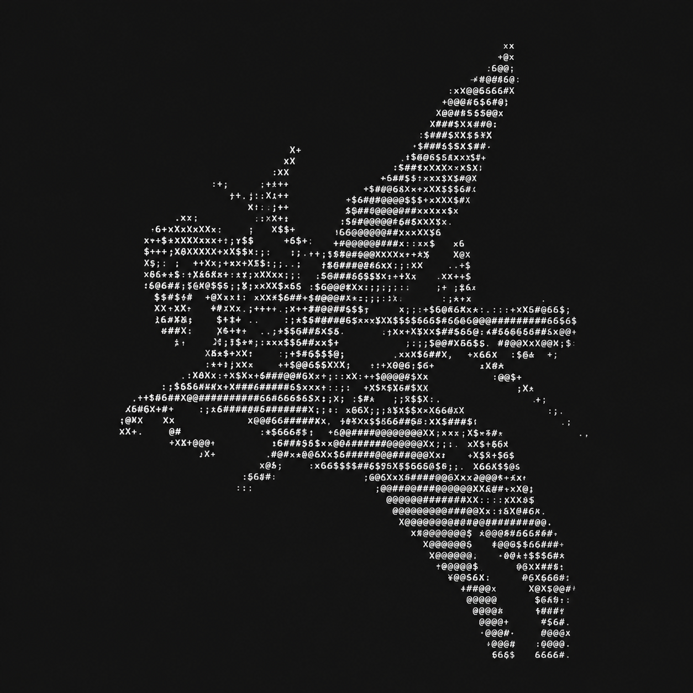

<p align="center">
  
</p>

<h1 align="center">Pegasus</h1>

<p align="center">
  geonq's desktop app for coding agents, on Windows and macOS.<br>
  A personal build of <a href="https://github.com/minghinmatthewlam/pi-gui">pi-gui</a>, running on the
  <a href="https://github.com/earendil-works/pi">pi</a> coding agent.
</p>

<p align="center">
  <a href="./LICENSE"></a>
  <a href="https://github.com/geonq/pi-gui/releases"></a>
  
</p>

Pegasus is the app I use every day to run coding agents. One Windows PC does the work:
it runs every conversation, model call and tool. My Mac is a native client for that same
backend, so a chat started on one machine continues on the other. Codex (ChatGPT), Claude and
Antigravity all sit side by side, with their quota and history in one place.

It started as a fork of [pi-gui](https://github.com/minghinmatthewlam/pi-gui) by Matthew Lam
and still runs every session through [pi](https://github.com/earendil-works/pi), so sessions,
models, sign-ins and tools behave exactly as they do in the pi CLI.

## What is different from pi-gui

- **Pegasus look.** An ASCII Pegasus mark, a compact neutral layout with dense navigation and
  small neutral actions, and native glass: Windows 11 acrylic and a matte macOS material.
- **Chats and Folders.** The sidebar switches between conversations and project folders.
  Opening a folder registers it without starting a chat, and empty projects stay out of the
  chat list.
- **Usage.** Tokens per account and model, a yearly heatmap, plan-limit meters for ChatGPT,
  Claude and Antigravity, and imported Codex, Claude Code and Antigravity CLI history. The
  import reads only numbers, timestamps and model names, never prompts or credentials.
- **Providers side by side.** ChatGPT through Codex sign-in, Claude through the official
  Claude Code CLI, and Antigravity, each with its own sign-in state.
- **Windows backend, Mac client.** The Mac app drives the Windows backend over an SSH-forwarded
  loopback port and can open or create project folders on either machine.
- **Quiet on Windows.** Background helpers, sign-in checks and Git calls run without
  flashing console windows.
- **Skills everywhere.** Global skills load in every project, and choosing a project adds
  its own skills without restarting running chats.
- **Faster start.** Startup writes the workspace catalog once in a batch instead of once per
  folder.

Everything pi-gui does is still here: parallel threads with optional git worktrees, the
review tab, a real terminal and file editor, scheduled tasks, extensions, the command palette,
fork and rewind, and themes.

## Install

Download the latest build from the [Releases page](https://github.com/geonq/pi-gui/releases).

- **Windows (x64):** run `Pegasus-<version>-x64-setup.exe`. The installer is not code-signed,
  so SmartScreen asks you to confirm: choose **More info → Run anyway**.
- **macOS (Apple Silicon):** unzip `Pegasus-<version>-arm64-mac.zip` and move `Pegasus.app` to
  Applications. The app is signed ad hoc, not notarized, so open it the first time with
  right-click → **Open**, or run `xattr -dr com.apple.quarantine /Applications/Pegasus.app`.

Pegasus works on its own like pi-gui. The Windows-backend/Mac-client link, CLI history import
and managed launch need my private Pi setup; without it they simply stay off.

## Quickstart

1. Open Pegasus.
2. Open **Settings → Providers** and sign in to ChatGPT, Claude (Claude Code) or Antigravity.
3. Switch the sidebar to **Folders** and open a project folder.
4. Click **New chat** and send your first prompt.

| Shortcut (macOS; use Ctrl on Windows)              | Does                                  |
| -------------------------------------------------- | ------------------------------------- |
| <kbd>⌘</kbd> <kbd>K</kbd>                          | Search chats, folders and actions     |
| <kbd>⌘</kbd> <kbd>P</kbd>                          | Open any file in the current checkout |
| <kbd>Ctrl</kbd> <kbd>Tab</kbd>                     | Switch between recent chats           |
| <kbd>⌘</kbd> <kbd>J</kbd>                          | Toggle the terminal                   |
| <kbd>⌘</kbd> <kbd>R</kbd>                          | Toggle the Review tab                 |
| <kbd>Enter</kbd> while a run is going              | Queue a follow-up                     |
| <kbd>⌘</kbd> <kbd>Enter</kbd> while a run is going | Steer the current run                 |

## Build from source

Requires Node 22.19 or newer and [pnpm](https://pnpm.io) through `corepack`.

```bash
corepack enable
pnpm install
pnpm dev                                         # run the app with hot reload
pnpm check                                       # format, lint, boundaries, types and unit tests
pnpm --filter @pi-gui/desktop run package:win    # Windows installer (on Windows)
pnpm --filter @pi-gui/desktop run package        # macOS app (on a Mac)
```

The app is an Electron shell with a typed IPC boundary between the React renderer
(`apps/desktop/src`), the preload bridge and the main process (`apps/desktop/electron`).
`packages/pi-sdk-driver` adapts the pi coding agent without forking it, and pi's own session
files stay the source of truth. See [docs/architecture.md](docs/architecture.md).

GitHub Actions is turned off for this repository; `pnpm check` (formatting, lint, architecture,
types and unit tests) runs locally before every release, and the release builds are packaged on
Windows and macOS directly. The workflow files from pi-gui stay in `.github/workflows` for
reference. The end-to-end UI suite inherited from pi-gui still targets the old pi-gui screens and
is being moved over to the Pegasus shell.

## Credits

- [pi-gui](https://github.com/minghinmatthewlam/pi-gui) by Matthew Lam, the app Pegasus is
  built from.
- [pi](https://github.com/earendil-works/pi) and
  [`@earendil-works/pi-coding-agent`](https://www.npmjs.com/package/@earendil-works/pi-coding-agent),
  the agent runtime underneath.
- [Bklit UI](https://github.com/bklit/bklit-ui) for the usage charts.

## License

[MIT](./LICENSE). The original pi-gui copyright notice is kept in the license file.
